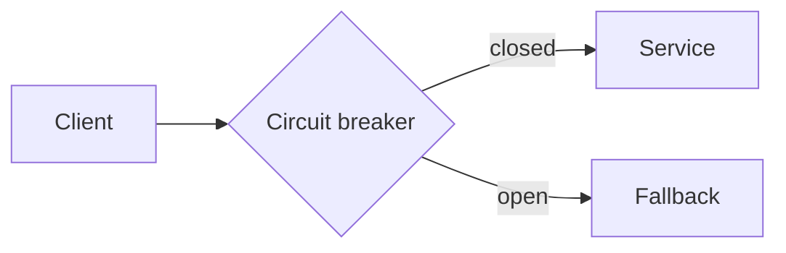

# Writing and publishing blog posts

A reference for adding posts to athiramk.com. Posts are plain markdown files, so there is no admin panel and no
database. Create a file, push it, and the site rebuilds.

## Quick start

```sh
npm run new-post "My Post Title"
```

This creates `src/content/blog/my-post-title.md` as a draft:

```md
---
title: "My Post Title"
summary: ""
date: 2026-11-11
tags: []
draft: true
---

Write your post here.
```

The date is today's date, and `draft: true` keeps the post off the live site until you remove it.

## Creating a post by hand

Add any `.md` file to `src/content/blog/`. The filename becomes the URL, so `circuit-breakers.md` is served at
`/blog/circuit-breakers`. Start the file with the same frontmatter block as above.

## Frontmatter reference

| Field | Required | What it is |
|---|---|---|
| `title` | yes | The post title. |
| `summary` | yes | One line shown in post lists, search and link previews. |
| `date` | yes | Publish date as `YYYY-MM-DD`. Posts are sorted newest first. |
| `tags` | no | A list such as `[java, concurrency]`. Keep tags lowercase. They create the sidebar links. |
| `cover` | no | A cover image path, e.g. `../../assets/blog/pic.jpg`. Put the image in `src/assets/blog/` first. |
| `coverAlt` | no | Alt text describing the cover image. Always fill this in if you set `cover`. |
| `draft` | no | `true` hides the post from the live site. Defaults to `false`. |

The fields are checked at build time (schema in `src/content.config.ts`). A misspelt field or a bad date fails the
build and names the file and the field, so a broken post can't go live by accident.

## Step by step

1. Create the file (`npm run new-post "..."` or by hand).
2. Fill in `title`, `summary`, `date` and `tags`.
3. Write the post in markdown below the frontmatter.
4. Preview it: run `npm run dev`, then open http://localhost:4321/blog/your-post-slug. Drafts are visible here only.
5. When it's ready, delete the `draft: true` line (or set it to `false`).
6. Commit and push to `main`:
   ```sh
   git add src/content/blog/my-post-title.md
   git commit -m "new post: my post title"
   git push
   ```
7. GitHub Actions builds and deploys the site. This takes a minute or two.

## Writing tips

- **Images inside a post:** put the file in `src/assets/blog/` and reference it as
  ``. Astro resizes and compresses it, and removes camera and GPS
  metadata.
- **Code blocks:** use triple backticks with a language, such as ```` ```java ````, to get syntax highlighting in
  light and dark mode. The special language `mermaid` draws a diagram instead (see Diagrams below).
- **Headings:** start sections at `##`. The post title is already the page's `#` heading.

## Callouts

Use GitHub-style alerts to highlight something. Start a quote with one of five labels:

```md
> [!NOTE]
> Useful information the reader should know.

> [!TIP]
> Helpful advice for doing things better.

> [!IMPORTANT]
> Key information the reader needs.

> [!WARNING]
> Something that needs attention.

> [!CAUTION]
> A risk of doing a certain thing.
```

Each one gets its own icon and colour, in both light and dark mode. A normal `>` quote without a label stays a plain
blockquote.

## Diagrams

Write a diagram as text in a code block marked `mermaid`, and it is drawn in the browser:

````md

````

Flowcharts, sequence diagrams, state diagrams, class diagrams and more are supported (see the
[Mermaid docs](https://mermaid.js.org/intro/)). Diagrams follow the dark mode toggle. The Mermaid library (a large
file) is only downloaded on pages that contain a diagram, so other pages stay fast. If a diagram has a syntax
error, the post shows the source text instead of breaking, so preview it with `npm run dev` before publishing. With
JavaScript turned off, readers see the diagram source as a code block.

## Share images

Every post gets a share image automatically, so links to it look good on LinkedIn, Slack, X and WhatsApp. At build
time `src/lib/og.ts` draws a 1200×630 card from the post's `title`, `summary` and `tags` and saves it as
`/og/<post-name>.png`; the post's `og:image` tag points to it. There is nothing to design or upload. Edit those
frontmatter fields and the card updates on the next deploy. Drafts get no card until they are published. Pages that
aren't posts share `/og/default.png`. A `cover` image is only shown on the post page itself, not on the share card.

## How tags work

- Each post lists its tags in frontmatter.
- `allTags()` in `src/lib/posts.ts` collects every tag from all published posts, removes duplicates and sorts them.
- `src/layouts/Base.astro` shows one sidebar link per tag, pointing to `/blog/tag/<tag>`.
- `src/pages/blog/tag/[tag].astro` builds one page per tag, listing the posts with that tag.

Adding a new tag to a post creates a new sidebar link and tag page on the next build. If the last post using a tag is
removed or still a draft, the tag disappears. Tag names are case-sensitive, so `Java` and `java` would be two
separate tags.

## What RSS is

RSS is a standard feed format. The site publishes one at `https://athiramk.com/rss.xml`, generated from your posts by
`src/pages/rss.xml.js`. Readers can add that URL to a feed reader app (Feedly, NetNewsWire, Inoreader and others) and
see each new post without visiting the site. Newsletter tools can also turn the feed into an email for each new
post. Nothing needs maintaining: it is rebuilt from your markdown files on every deploy.

## Troubleshooting

- **The build fails.** Read the error: it names the post and the frontmatter field that is wrong (often a bad date
  or a missing `title` or `summary`). Run `npm run build` locally before pushing to catch it early.
- **The post isn't on the live site.** Check that `draft: true` is removed, that the change is committed and pushed to
  `main`, and that the "Deploy to GitHub Pages" run on GitHub's Actions tab succeeded.
- **The post appears locally but not in the tag list.** Tags only come from published posts, so a draft's tags don't
  appear in production.
- **A diagram shows as plain code in `npm run dev`.** The dev server was started before a config change and is
  still using the old settings. Stop it (`Ctrl+C`, or `npx astro dev stop` if it was left running in the
  background) and start it again with `npm run dev`.
- **A cover image isn't found.** The path is relative to the post file, so it should start with
  `../../assets/blog/`.

## Deployment note

`.github/workflows/deploy.yml` deploys from the `main` branch. The Astro revamp was built on the `index-update`
branch, so it has to be committed and merged to `main` before it goes live. GitHub Pages must be set to deploy from
"GitHub Actions" in the repository settings.

## Useful commands

```sh
npm run new-post "Title"   # create a draft post
npm run dev                # local preview at http://localhost:4321
npm run build              # production build into dist/ (also builds search)
npm run preview            # serve the built site locally
```
